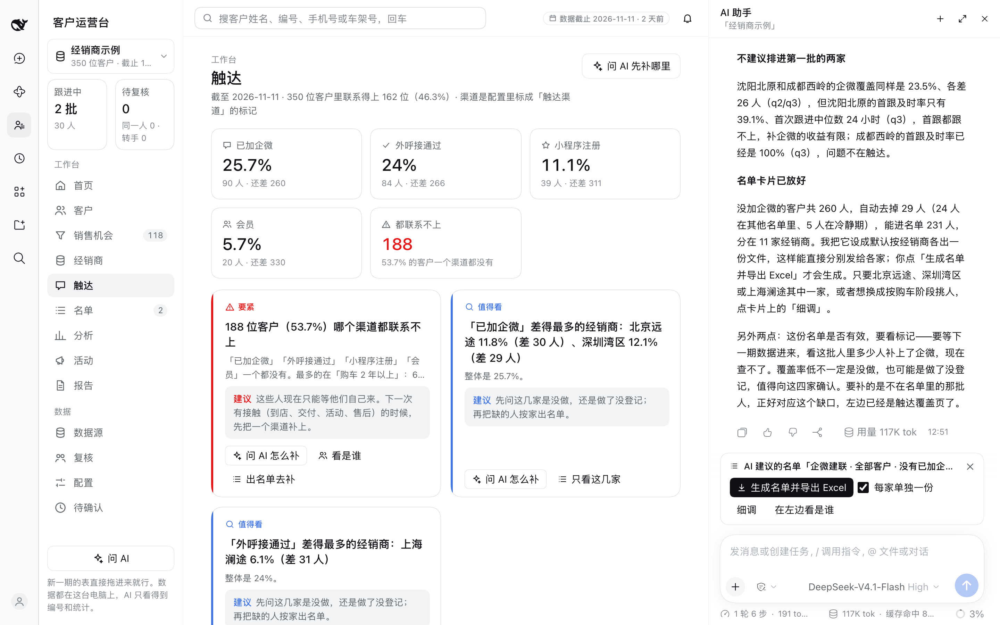
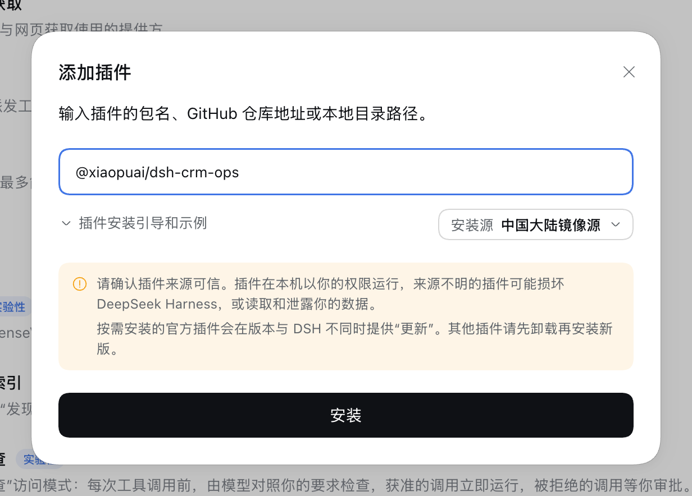
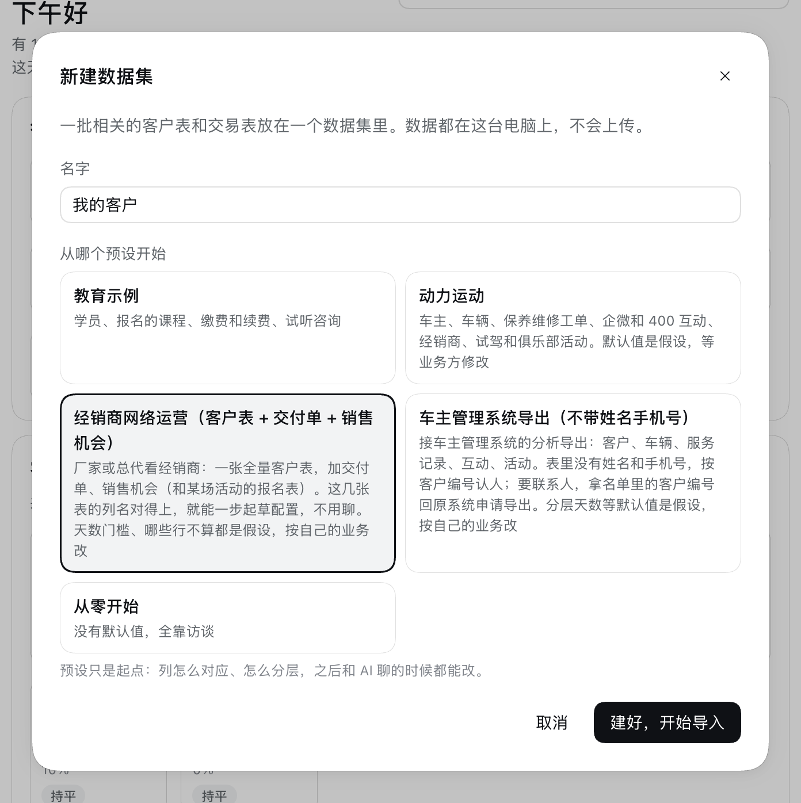
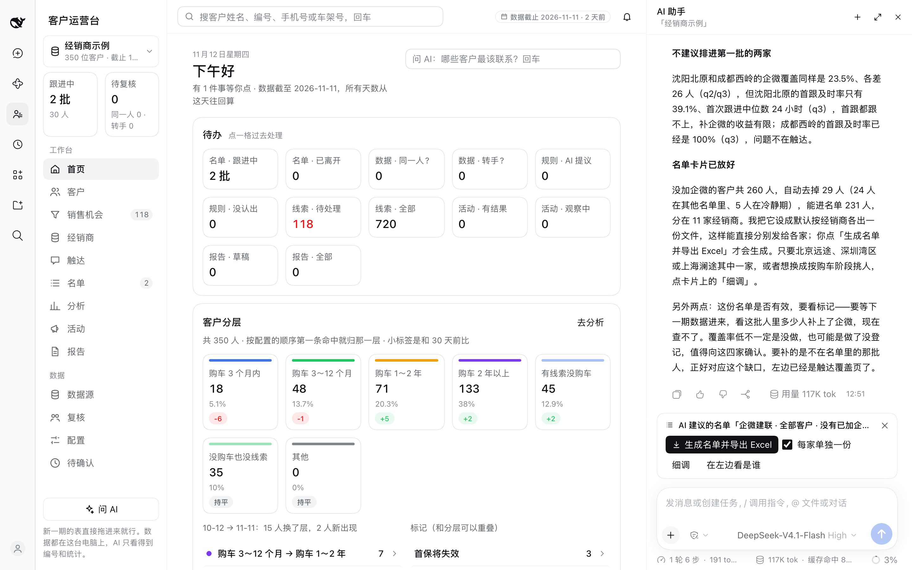
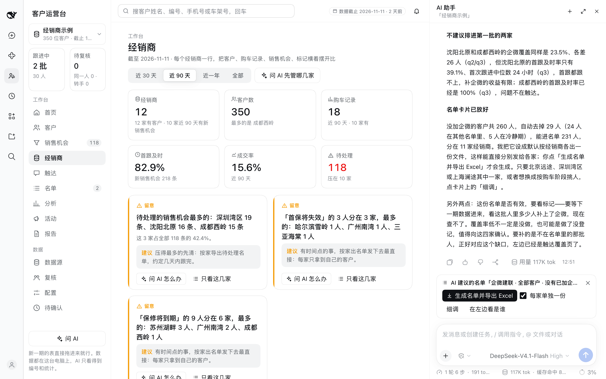
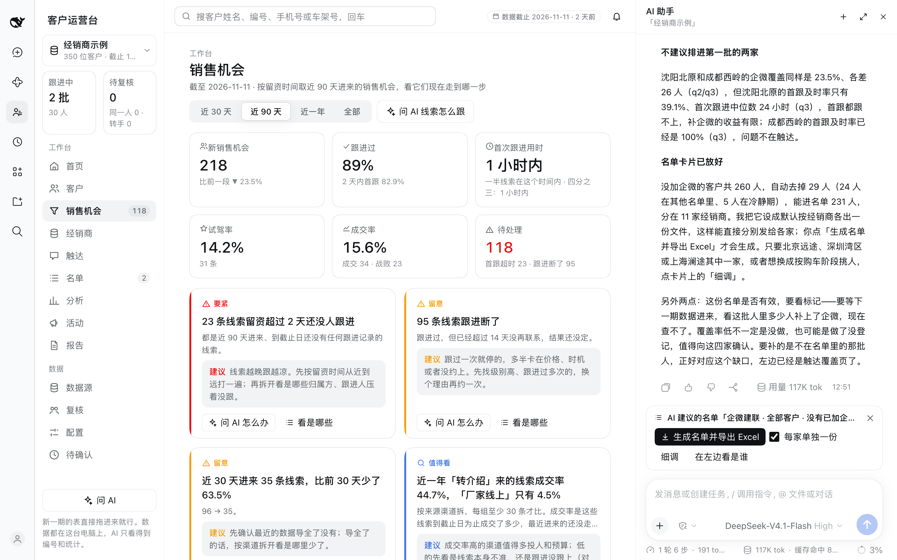
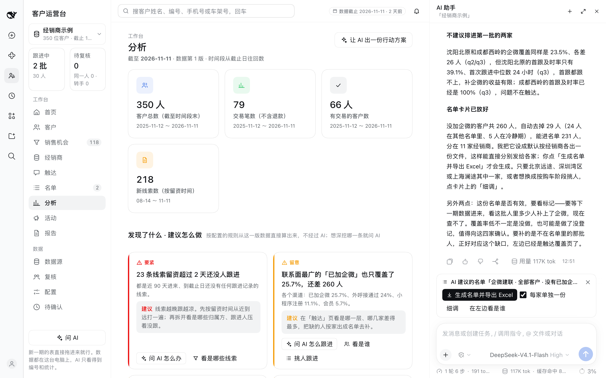

<div align="center">


# 客户运营台

**把几个系统导出的客户表拖进来，AI 帮你看懂：谁该联系、哪一家该管、名单怎么出。**

DeepSeek Harness 插件 · 拖表就能用 · 右边常驻 AI 助手 · 数据只存在你自己的电脑上

[](https://www.npmjs.com/package/@xiaopuai/dsh-crm-ops)
[](https://github.com/deepseek-ai/deepseek-harness)
[](LICENSE)

[三步开始](#三步开始) · [能做什么](#能做什么) · [常见问题](#常见问题) · [功能详解](docs/FEATURES.md) · [English](#english)

</div>

<br>



<p align="center"><sub>截图里是仓库自带的示例数据，人名、经销商、数字全是编的。</sub></p>

## 能做什么

| | |
|---|---|
| 🧹 **几张表拖进来就能用** | 客户表、交易表、线索表、活动报名表，Excel 和 CSV 直接拖。插件自己体检、清洗，把同一个人合成一行，再按你的规则分层 |
| 💬 **有事直接问右边的 AI** | 「哪几家经销商最该先补企微」「这个月线索为什么少了」。回答里的每个数都有出处，结论落在卡片上，点一下就生成名单或报告 |
| 📋 **名单从挑人到看结果** | 挑人、去重、避开刚联系过的人，导出给销售去跟。下一期数据导进来，自动看这批人成没成 |
| 🏪 **总部看每一家** | 线索跟得及不及时、成交率、客户联系得上多少，每个经销商（门店、校区）一行，谁落后一眼看到，还能给每家单独导一份 |
| 🔒 **数据只在你电脑上** | 表和结果都存在本机。右边的 AI 助手只看得到客户编号和统计数字，看不到姓名、手机号和备注原文 |

## 三步开始

**开始前准备好：**

- 电脑上装好了 [DeepSeek Harness](https://github.com/deepseek-ai/deepseek-harness)（0.2.x 版本）
- 几张从你的系统里导出的表（Excel 或 CSV）。手头没有的话，先用仓库里 [`示例数据/`](示例数据) 的几套编的数据试

### ① 安装插件

1. 打开 DeepSeek Harness，点左边的 **插件**
2. 点右上角的 **添加插件**，在输入框里填：

   ```
   @xiaopuai/dsh-crm-ops
   ```

3. 点 **安装**。装好后点 **立即启用**，左边会多出一个 **客户运营**



> [!TIP]
> 提示「不兼容」、装不上？说明 DeepSeek Harness 的版本太旧了。点左下角的 **新版本** 升级，再装一次。

### ② 建一个数据集，把表拖进来

1. 点左边的 **客户运营**，点 **新建数据集**：起个名字，选一个最接近你业务的预设（都不像就选「从零开始」）
2. 把导出的表直接拖进页面，可以一次拖好几张
3. 跟着页面顶上的进度条走：体检 → 确认数据截止日 → 配置 → 清洗合并 → 复核。「配置」这一步交给右边的 AI：它先看体检结果，拿不准的地方问你，最后你在卡片上点 **定稿**



> [!TIP]
> 想先看看效果：下载 [`示例数据/经销商示例`](示例数据/经销商示例) 里的四张表，预设选「经销商网络运营」，拖进去以后页面上会出现 **按预设直接起草**，点几下就能看到看板，这一路不需要 AI。

### ③ 看数据，有事问右边的 AI

数据准备好以后，左边是看板，右边是 AI 助手，两边一直都在。

- **首页**：有几件事等你处理、客户分成了哪几层、近 30 天谁换了层
- **客户 / 销售机会 / 经销商 / 触达**：每页先说「发现了什么、建议怎么做」，再给明细。每条发现旁边都有「问 AI 怎么办」和「看是谁」
- **名单**：挑一批人去联系，导出给销售；结果回来以后在这里看
- **右边的 AI 助手**：直接用中文问。它回答时会把左边切到正在说的那一页；要生成名单、导出文件、定稿报告，它放一张卡片，由你来点
- **每周的新数据**：新一期的表直接拖进来，和上次对得上的会自动接着清洗

| 首页：待办和客户分层 | 经销商：每家一行，先挑出要管的几家 |
|:---:|:---:|
|  |  |
| **销售机会：跟进、试驾、成交的漏斗** | **分析：发现了什么，建议怎么做** |
|  |  |

## 常见问题

<details>
<summary><b>装不上，提示「不兼容」</b></summary>

<br>

插件支持 DeepSeek Harness **0.2.2-rc.1 及之后的所有 0.2 版本**。提示不兼容，多半是 DeepSeek Harness 太旧：点左下角 **新版本** 升级后再装。

如果 DeepSeek Harness 已经是 0.3 或更新、而这里还没出对应的新版本，请[提一个 issue](https://github.com/xiaopu-ai/dsh-plugin-crm/issues)。

</details>

<details>
<summary><b>我的表和预设里的不一样，能用吗？</b></summary>

<br>

能。插件不要求固定的列名：预设只是一个起点，带着这个行业常见的分层和标记。你的表有哪些列、哪一列是什么意思，是在「配置」这一步和右边的 AI 聊出来的，它拿不准会问你，定稿之前什么都不会生效。

明细表（一行一个客户、一行一笔交易、一行一条线索）才用得上；已经汇总好的报表用不了，体检时会告诉你。

</details>

<details>
<summary><b>AI 能看到我客户的姓名和手机号吗？</b></summary>

<br>

客户运营台右边那一栏的助手看不到。它没有读文件、跑命令、上网的工具，只能通过插件拿数；插件给它的东西都先遮一遍：客户只给编号，敏感的列只给统计，文字里的手机号、证件号、车架号、邮箱都遮掉。

要注意：DeepSeek Harness 自带的通用助手（在「新会话」里聊的那个）不受这个限制。它能读你电脑上的文件，你让它去读 `文稿/客户运营/` 里的表，它读到的就是原表。所以客户数据的事，请在客户运营台右边的对话栏里问。

</details>

<details>
<summary><b>数据存在哪？怎么备份、怎么删？</b></summary>

<br>

每个数据集一个文件夹，在 `文稿/客户运营/<数据集名>/`：你导入的原表、清洗后的数据、名单、报告和你做过的所有决定都在里面，插件不会把它们传到任何服务器。备份就是复制这个文件夹。

在插件里删除数据集或文件，只是移到这个文件夹的 `回收站/` 里。

只有在你问 AI 时，遮过的统计数字和客户编号才会发给你在 DeepSeek Harness 里设置的模型。

</details>

<details>
<summary><b>没有 DeepSeek 账号能用吗？AI 要花钱吗？</b></summary>

<br>

插件本身免费。导入、清洗、看板、名单、导出都不需要账号，也不经过 AI；只有「问 AI」和让 AI 帮你配置需要。AI 用的是你在 DeepSeek Harness 里设置的模型，按那个模型的规则计费。

</details>

<details>
<summary><b>名单「成没成」是怎么算的？</b></summary>

<br>

两种算法，生成名单时可以选：

- **看交易**：这批人联系完以后，下一期数据里有了新的交易才算。
- **看标记**：圈的是「没有某个标记的人」（比如没加企微的），下一期数据里带上了这个标记才算。

两种都会和「同一层里、没进名单的人」放在一起比，并且都要等下一期数据导进来才有数。两边的差别是参考，不等于名单带来的增量。

</details>

<details>
<summary><b>怎么升级插件？</b></summary>

<br>

按上面的方法（填包名）装的：在 **插件** 里打开 **客户运营台**，页面下方的 **版本** 一栏会自动检查新版本，有新版本时点 **更新**。数据集在 `文稿/客户运营/`，升级不会动。

从 GitHub 地址或压缩包装的：不会自动提示更新，用同样的方式再装一次即可。

</details>

<details>
<summary><b>DeepSeek Harness 升级后，插件还能用吗？</b></summary>

<br>

在 0.2 系列里升级（比如 0.2.2、0.2.3），插件照常能用。

升到 0.3 时插件接口可能有变化，DeepSeek Harness 会先暂停这个插件，自己正常启动，数据不受影响。到时装这里对应的新版本就能恢复。

</details>

<details>
<summary><b>电脑上没装 DeepSeek Harness 怎么办？</b></summary>

<br>

两个办法：先装 [DeepSeek Harness](https://github.com/deepseek-ai/deepseek-harness) 再按上面三步走；或者从 [Releases](https://github.com/xiaopu-ai/dsh-plugin-crm/releases) 下载 `dsh-crm-ops-launcher-v<版本>.zip`，解压后双击「启动客户运营台.command」（Mac，需要 Node.js 22.19 或更新），它会自己把 DeepSeek Harness 装在旁边再打开。详见[开发者文档](docs/DEVELOPMENT.md#其他安装方式)。

</details>

<details>
<summary><b>怎么卸载？</b></summary>

<br>

在 **插件** 里打开 **客户运营台**，点右上角 **卸载**。数据集留在 `文稿/客户运营/`，重新安装后还在；不想要了直接删掉这个文件夹。

</details>

## 更多

- 📖 [功能详解](docs/FEATURES.md)：每个页面是什么、每个数怎么来的、配置能表达什么、AI 的边界在哪
- 🛠️ [开发者文档](docs/DEVELOPMENT.md)：其他安装方式、改代码、加自己的预设、打包发给别人
- 🧪 [`示例数据/`](示例数据)：四套编的数据（经销商、教育、动力运动、车主系统），对应四个自带的预设
- 💬 有问题或想法：[提一个 issue](https://github.com/xiaopu-ai/dsh-plugin-crm/issues)

## English

**客户运营台 (Customer Ops)** is a [DeepSeek Harness](https://github.com/deepseek-ai/deepseek-harness) plugin for customer operations. Drop in the customer, transaction and lead tables your systems export (Excel or CSV); the plugin profiles and cleans them, merges them into one row per person and segments them by your rules. An AI assistant stays beside the boards to configure the tables, explain what changed, compare dealers or stores, and propose contact lists and cited reports that you confirm with a click. Data stays on your machine, and the plugin's assistant only sees customer codes and statistics. The UI is in Chinese.

**Install:** in DeepSeek Harness 0.2.x, open **Plugins → Add plugin**, enter `@xiaopuai/dsh-crm-ops` and click **Install**. Sample data to try it with is in [`示例数据/`](示例数据).

## 声明

本项目是个人开源项目，与 DeepSeek 无关联。示例数据和截图里的人名、公司、品牌、数字都是编的。看板上的发现和建议是按你定稿的规则算出来的，预设里的天数门槛都是假设，用之前请按自己的业务核对。

## 许可

[MIT](LICENSE) © 2026 xiaopu-ai。`dsh-crm-ops/lib/vendor/xlsx.mjs` 是 SheetJS Community Edition（Apache-2.0），许可见 `dsh-crm-ops/lib/vendor/LICENSE-sheetjs`。
