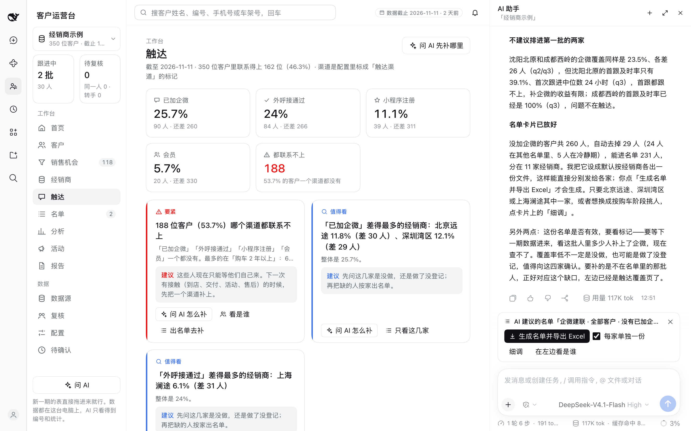

# 客户运营台

**把几个系统导出的客户表拖进来，AI 帮你看懂：谁该联系、哪一家该管、名单怎么出。**

DeepSeek Harness 插件：拖表就能用，插件自己体检、清洗、把同一个人合成一行、分层；右边常驻的 AI 助手帮你配表、看数据、出名单和报告。数据只存在你自己的电脑上，这个助手只看得到客户编号和统计数字。

## 安装

在 DeepSeek Harness 0.2.x（0.2.2-rc.1 起）里：**插件 → 添加插件**，填 `@xiaopuai/dsh-crm-ops`，点 **安装**，再点 **立即启用**。

## 装好以后

1. 点左边的 **客户运营**，**新建数据集**：起个名字，选一个最接近你业务的预设
2. 把导出的 Excel 或 CSV 拖进页面，跟着顶上的进度条走；「配置」这一步交给右边的 AI，你在卡片上点 **定稿**
3. 看板在左边，有事直接问右边的 **AI 助手**；生成名单、导出、定稿报告都是它放卡片、你来点

想先看看效果：仓库的 `示例数据/经销商示例` 里有四张编的表，预设选「经销商网络运营」，不用 AI 也能走通。

**数据在哪**：`文稿/客户运营/<数据集名>/`，升级和卸载插件都不会动它。

**升级**：在 **插件 → 客户运营台** 页面下方的 **版本** 一栏点 **更新**。

更多截图、常见问题和详细说明：https://github.com/xiaopu-ai/dsh-plugin-crm

MIT © 2026 xiaopu-ai。`lib/vendor/xlsx.mjs` 是 SheetJS Community Edition（Apache-2.0）。
